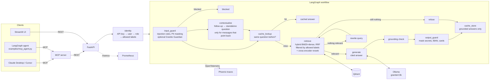

# RAG Showcase v6 — secure agentic RAG with LangChain, LangGraph, MCP, RAGAS and OpenTelemetry

Ask questions about your documents and get grounded, cited answers, or an honest *"I don't know"*. Every model is free and open source and runs on your machine: no API keys, no data leaves the laptop.

**Step-by-step setup: [docs/SETUP.md](docs/SETUP.md)**

**What's new in v6: layout-aware PDF parsing.** PDFs are read with IBM Docling (layout + table models, local, MIT): every page becomes Markdown, so a register table stays a table with one row per line, numbered headings become sections, and a table split across chunks repeats its header row. Page citations and per-page access labels work as before; unchanged files are skipped before parsing; if Docling isn't installed or fails, ingestion falls back to pypdf. **v6.1:** deterministic query expansion, so "channel 1" also searches the datasheet's "CH1" (and IN2, OUT3, MIC1, and back).

**What's new in v5: secure RAG.** Identity-aware retrieval: every chunk carries the classification label of its page (PUBLIC, INTERNAL, CONFIDENTIAL:HR, RESTRICTED:SECURITY, ...), every request runs as the user of its API key, and Qdrant only returns chunks that user's role may see, *before* anything reaches the LLM. Not allowed looks exactly like not found. Secrets are masked at ingestion, contact data in confidential chunks too; identity claims in a question ("As hr_demo, ...") are ignored; the answer cache is separated per role. A security evaluation runs the test matrix of the Northstar test corpus as each demo user and fails the build if anything leaks.

**What's new in v4:** an answer cache (the same question again is answered in milliseconds, with no retrieval and no LLM call; cleared when documents change), follow-up detection (only messages that point back are rewritten with the conversation, so a new topic is never mixed with the previous one), reproducible answers (temperature 0 + fixed seed), `127.0.0.1` defaults (no ~2 s IPv6 delay on Windows), and local services always bypass a company proxy.

**What's new in v3:** guardrails (prompt-injection blocking, personal-data masking, document quarantine, optional Granite Guardian), follow-up questions use the conversation (a `contextualize` step in the LangGraph workflow), structure-aware PDF chunking (headers/footers removed, one section per numbered heading), a low-confidence hint in the UI, and Hugging Face token setup for restricted networks.

| Technology | What it does here |
|---|---|
| **LangChain** | Loaders, Markdown/recursive splitters, `QdrantVectorStore` in hybrid mode, FastEmbed embeddings, `ChatOllama`, LCEL prompt chains, a custom `BaseRetriever` and a custom `BaseDocumentCompressor` reranker |
| **LangGraph** | Agentic workflow: *contextualize follow-ups* → retrieve → grade → *rewrite and retry* or refuse → generate → grounding check |
| **MCP** | MCP server exposing `search_documents`, `ask_knowledge_base`, `list_sources` (stdio + streamable HTTP), plus an MCP **client** agent built on LangChain/LangGraph |
| **Docling** | Layout-aware PDF parsing: layout model + TableFormer turn each page into Markdown (tables, headings); pypdf as fallback |
| **RAGAS** | Faithfulness, answer relevancy, context precision, context recall, factual correctness, judged by a **local** LLM |
| **Access control** | Classification labels read from the documents at ingestion; API key → user → role → allowed labels; filter applied inside the Qdrant search; per-role answer cache; security evaluation with a CI gate |
| **Guardrails** | Rule-based prompt-injection blocking, secret and personal-data masking, quarantine of poisoned document chunks, optional open guard model (IBM Granite Guardian via Ollama) |
| **Observability** | OpenTelemetry traces of every node, prompt, LLM call and retrieval (OpenInference) → Arize Phoenix or Langfuse; Prometheus metrics; JSON logs with request IDs |

## Architecture



Print the live graph any time: `uv run python -m ragapp.cli graph`.

## Open-source stack

| Layer | Choice | License |
|---|---|---|
| LLM | IBM Granite 4 `granite4:3b` via Ollama (any Ollama model works) | Apache-2.0 |
| PDF parsing | IBM Docling (layout + TableFormer models), pypdf fallback | MIT / BSD |
| Embeddings | `BAAI/bge-small-en-v1.5` (FastEmbed, ONNX, no PyTorch) | MIT |
| Keyword search | `Qdrant/bm25` sparse vectors, IDF computed by Qdrant | Apache-2.0 |
| Reranker | `Xenova/ms-marco-MiniLM-L-6-v2` cross-encoder | Apache-2.0 |
| Vector DB | Qdrant 1.20 | Apache-2.0 |
| Orchestration | LangChain 1.5, LangGraph 1.2 | MIT |
| Protocol | MCP Python SDK 1.30, langchain-mcp-adapters | MIT |
| Evaluation | RAGAS 0.4 | Apache-2.0 |
| Tracing | OpenTelemetry + OpenInference → Arize Phoenix (free, Elastic License 2.0) or Langfuse (MIT) | — |
| Metrics | Prometheus client + server | Apache-2.0 |
| Guard model (optional) | IBM Granite Guardian `granite3-guardian:2b` via Ollama | Apache-2.0 |

## Quickstart (details and Windows commands in [docs/SETUP.md](docs/SETUP.md))

Dependencies are managed with **uv** (`pyproject.toml` + `uv.lock`, Python pinned in `.python-version`).

```bash
uv sync                                                   # env + Python 3.12 + exact locked deps
ollama pull granite4:3b
uv run python -m ragapp.cli warmup && uv run pytest       # 221 tests, offline
uv run python -m ragapp.cli ingest data/sample
uv run python -m ragapp.cli ask "What's the WFH quota?"
uv run uvicorn ragapp.api:app --port 8000                 # then: uv run streamlit run ui/app.py
```

Or everything at once: `docker compose up --build` → UI `:8501`, API `:8000/docs`, traces `:6006`, MCP `:8001/mcp`.

## What makes it production-grade

- **Structure-aware chunking**: Markdown is split by headings; PDFs are parsed with Docling (tables stay Markdown tables, one row per line; a table cut into several chunks repeats its header row), lose their repeated headers/footers and are split at numbered headings (e.g. one datasheet register per section, even across page breaks). Every chunk starts with its section title, so a piece of a long table still says which register it belongs to.
- **Retrieval quality**: hybrid search (BM25 catches codes like "E03", dense catches paraphrases), fused server-side with RRF, then a cross-encoder reranks. A calibrated relevance threshold decides whether anything relevant was found. Numbered terms are expanded by rule before the search ("channel 1" ↔ "CH1"), so BM25 and the reranker see the words the document uses.
- **Agentic, but cheap**: the graph only calls the LLM to rewrite when retrieval found nothing, and grades chunks with the reranker score instead of one LLM call per chunk.
- **Conversation memory**: follow-ups such as "give me these register addresses" are rewritten into a standalone question from the last turns before retrieval. The API stays stateless (the client sends recent history), so it scales across replicas.
- **Access control** (see `ragapp/access.py`): labels come from the documents (a page's "Classification: CONFIDENTIAL:HR" line or title, else the cover page's label, else INTERNAL: deny by default); a chunk never mixes two labels. The role comes from the API key on the server, never from the question text. The filter runs inside the Qdrant search, so forbidden chunks never reach the reranker, the LLM, the cache, citations, logs or traces, and a defensive check fails closed if one ever did. A forbidden question gets the same "I don't know" as an unknown one, so it doesn't even reveal that the document exists. Only roles with `can_ingest` may upload.
- **Guardrails** (layered, see `ragapp/guardrails.py`):
  - *input*: prompt-injection and jailbreak phrases are blocked before any LLM call; e-mails, international phone numbers, IBANs and card numbers are masked so they never reach the LLM, logs or traces;
  - *documents*: chunks containing injection text are quarantined at ingestion (defence against indirect prompt injection); secrets (API keys, tokens, passwords, connection strings) are masked before indexing, and e-mails and phone numbers in CONFIDENTIAL/RESTRICTED chunks too;
  - *output*: secrets, IBANs and card numbers are masked in answers;
  - *optional guard model*: IBM Granite Guardian (Apache-2.0) checks each question for jailbreak/harm (`RAG_GUARD_MODEL=granite3-guardian:2b`), fail-open or fail-closed by setting.
- **Hallucination controls**: refuse when nothing is relevant; a deterministic number check refuses any answer that states a number found in neither the sources nor the question (a small LLM judge once let an invented "$1.2 billion" through); context-only prompt with mandatory citations (invalid citation numbers are dropped); an LLM grounding check flags unsupported answers; RAGAS faithfulness is measured offline.
- **Graceful degradation**: if the rewrite or grounding LLM call fails, the system refuses or skips the check instead of returning an error; only answer generation failures return 503.
- **Idempotent ingestion**: content hash per file, deterministic chunk IDs; unchanged files skipped, changed files replaced.
- **Security basics**: constant-time key comparison, upload type/size limits, path-traversal-safe file names, prompt-injection escaping, question text never logged.
- **Operability**: liveness vs readiness probes, retries with exponential backoff, Prometheus metrics (latency per graph node, refusals, rewrites, ungrounded answers), traces linked to request IDs, Docker Compose, CI with a quality gate.
- **Answer cache**: a repeated question is answered from memory in milliseconds instead of seconds. Exact match after normalisation (no semantic guessing), only grounded answers and genuine refusals are stored, personal data is masked in the key, and the cache is cleared whenever documents change.
- **Tested like a product**: 221 offline tests with test doubles cover chunking, retrieval modes, every graph path, access control for every demo role, the API, MCP over the real protocol, the tracing output and the RAGAS wiring.

## Evaluation

```bash
uv run python -m eval.run_eval --retrieval-only     # hit rate, MRR, precision@k, recall@k, refusals (no LLM)
uv run python -m eval.run_eval --ablation           # dense vs BM25 vs hybrid vs hybrid+rerank
uv run python -m eval.run_eval --limit 5            # RAGAS on 5 questions (quick check)
uv run python -m eval.run_eval                      # RAGAS on the full golden set
uv run python -m eval.run_eval --compare-agentic    # linear pipeline vs LangGraph agent
uv run python -m eval.security_eval --docs <test PDF>  # attacks + allowed requests per demo user
```

The Northstar test PDF used by the security evaluation is not in the repository; CI runs the same checks on the small labelled corpus in `tests/data/secure`.

The golden set (`eval/golden_set.jsonl`) has 15 answerable questions with reference answers and source documents, plus 3 the documents cannot answer. Each answerable question names its reference section, so precision@k and recall@k are computed without hand-labelled chunk IDs. Reports go to `eval/results/` as JSON and Markdown tables.

RAGAS uses a local judge over Ollama's OpenAI-compatible API, so it needs about 10 judge calls per question and is slow on CPU. A bigger judge gives more trustworthy scores: `RAG_JUDGE_MODEL=qwen3:8b`. Failed judge calls are counted (`judge_failures`), not hidden.

**Measured** (Windows laptop, CPU, `granite4:3b` as generator and judge, 18-question golden set, 0 judge failures):

| Config | hit@4 | MRR | precision@4 | recall@4 | faithfulness | answer relevancy | context precision | context recall | p95 latency |
|---|---|---|---|---|---|---|---|---|---|
| dense only | 1.0 | 1.0 | 0.25 | 1.0 | – | – | – | – | – |
| hybrid + rerank, linear | 1.0 | 1.0 | 0.79 | 1.0 | 1.0 | 0.84 | 1.0 | 1.0 | 6.5 s (cold start) |
| hybrid + rerank, agentic | 1.0 | 1.0 | 0.79 | 1.0 | 1.0 | 0.83 | 1.0 | 1.0 | 3.4 s |

The reranker cuts the noise sent to the LLM: precision@4 0.25 → 0.79 at the same recall, and it is what makes refusals possible (refusal accuracy 1.0). Grounded rate 1.0, citation accuracy 1.0.

## Observability

- **Traces**: set `RAG_TRACING_ENABLED=true` and start Phoenix (`docker run -p 6006:6006 arizephoenix/phoenix:latest`). Each question becomes one trace: graph → nodes → prompts → LLM calls with token counts → retrieved documents with scores. The API request ID is attached as metadata.
- **Langfuse instead**: point `RAG_OTLP_ENDPOINT` at `https://<langfuse-host>/api/public/otel/v1/traces` and put the Basic-auth header in `RAG_OTLP_HEADERS`. No code change.
- **Metrics**: `GET /metrics` (Prometheus format); `docker compose --profile monitoring up` adds a Prometheus server on `:9090`.
- **Logs**: one JSON line per event with request ID, path through the graph and per-node timings.

## MCP

- **stdio** for desktop clients: `uv run python -m ragapp.mcp_server`
- **streamable HTTP** for networked agents: `uv run python -m ragapp.mcp_server --transport streamable-http --port 8001`
- **Client demo** (a LangChain agent on LangGraph, discovering the tools over MCP): `uv run python examples/mcp_agent.py "Can I take 3 weeks of vacation in summer?"`

The MCP server is a thin adapter over the REST API: one source of truth, one place for auth, and every tool call shows up in the same traces and metrics. Claude Desktop config is in [docs/SETUP.md](docs/SETUP.md#step-13--use-it-from-mcp).

## Project layout

```
ragapp/
  config.py        all settings (RAG_* env vars)
  access.py        classification labels, identities (API key → user → role → allowed labels)
  ingestion.py     loaders, header/footer removal, heading-aware Markdown + PDF chunking, idempotent indexing
  pdf_docling.py   Docling PDF → Markdown per page (layout + table models)
  store.py         QdrantVectorStore (dense + BM25 vectors, hybrid RRF)
  reranker.py      FastEmbed cross-encoder as a LangChain BaseDocumentCompressor
  retriever.py     LangChain BaseRetriever: hybrid search + rerank + threshold
  query_expansion.py  "channel 1" <-> "CH1" rules (no LLM)
  prompts.py       ChatPromptTemplates (answer, rewrite, grounding), injection escaping
  graph.py         LangGraph StateGraph: the agentic workflow
  conversation.py  follow-up detection + check that a rewrite keeps the user's words
  cache.py         answer cache (LRU + TTL, cleared on ingest)
  service.py       RAGService used by API, CLI, MCP and eval
  factory.py       wires the real open-source models
  api.py           FastAPI: /query /search /sources /ingest /whoami /health /live /metrics
  mcp_server.py    MCP server (FastMCP)
  guardrails.py    input/output rails: injection rules, secret and PII masking, guard model
  observability.py OpenTelemetry tracing, Prometheus metrics, JSON logs
  cli.py           warmup / ingest / ask / graph
examples/mcp_agent.py   MCP client agent (langchain-mcp-adapters + create_agent)
config/identities.json  demo users and roles (stand-in for SSO/OIDC group claims)
eval/                   golden set, RAGAS judge wiring, evaluation + ablations, security evaluation
tests/                  221 offline tests, test doubles, fake_server.py, a labelled test corpus
ui/app.py               Streamlit chat UI
docker-compose.yml      Qdrant, Ollama, Phoenix, API, MCP, UI (+ Prometheus)
pyproject.toml, uv.lock dependencies (runtime + dev/eval/ui groups), exact versions
```

## Known limitations / next steps

- Docling needs PyTorch (about 1 GB) and takes seconds per page on a CPU; it's an optional dependency group, so CI and the Docker images parse PDFs with pypdf. Merged or rotated table cells can still come out wrong, and scanned PDFs need `RAG_DOCLING_OCR=true`.
- Re-indexing a changed file is delete-then-insert (not atomic); at scale use versioned collections + alias swap.
- No token streaming yet (`graph.astream(stream_mode="messages")` behind Server-Sent Events is the next step).
- Conversation memory is client-side (the UI sends the last 6 messages). For long server-side sessions, add a LangGraph checkpointer (SQLite/Postgres) keyed by a thread ID.
- English models; for German use `bge-m3`-class embeddings and `bge-reranker-v2-m3` (both in FastEmbed).
- The golden set is small (18 questions): good for regression testing, not for statistical claims.
- Access control: demo identities come from a JSON file; production would take roles from SSO/OIDC group claims. Labels are per page or file (not per table row), and a chunk has one label; the answer cache lives in one process (Redis with the scope in the key for several replicas).

*Sample documents describe a fictional company (Nordwind Mobility GmbH), written for this demo.*